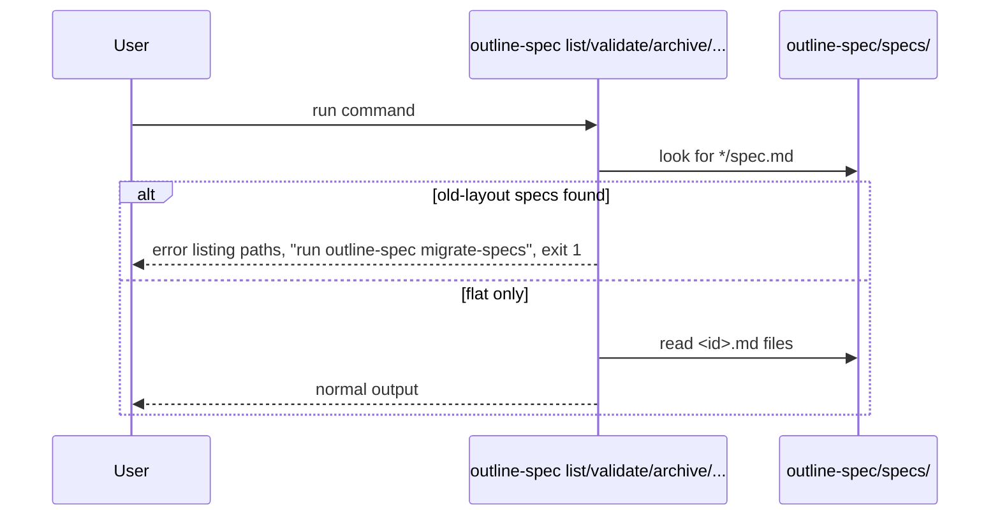

# Diagrams

Each spec folder collapses to one file named for the spec's id.

<sub>Live Specs File Tree</sub>

```diff
 outline-spec/specs/
-├── cli-list/
-│   └── spec.md
+├── cli-list.md
 ├── platform/
-│   └── session-layout/
-│       └── spec.md
+│   └── session-layout.md
-└── review-page/
-    └── spec.md
+└── review-page.md
```

`migrate-specs` handles each old-layout spec one of four ways.

<sub>Migrate-specs Outcomes Table</sub>

| Found | Result | Exit |
|---|---|---|
| `<id>/spec.md`, no `<id>.md` | Moved to `<id>.md` (git rename in a work tree); empty folder removed | 0 |
| `<id>/spec.md` and other files in `<id>/` | Moved; folder kept, other files named in the report | 0 |
| `<id>/spec.md` and `<id>.md` both exist | Not moved; reported as a conflict | non-zero |
| Only flat files | Nothing moved; says so | 0 |

Any other command that reads specs stops before doing anything.

<sub>Old Layout Guard Sequence</sub>


