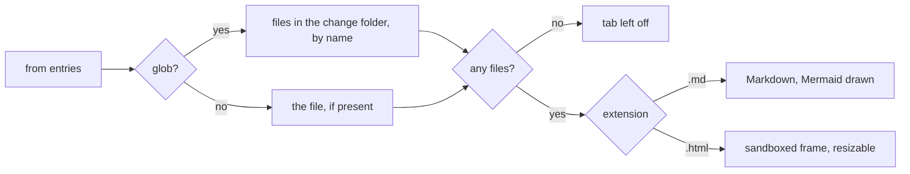

# Diagrams

A file tab now picks how to show each file by its extension, and a glob that matches nothing drops the tab.

File tab rendering

Where a design lives across a change's life.

Design lifecycle

| Step | designs/ | Review page |
|---|---|---|
| Propose, visual change | Written | Designs tab |
| Propose, no visual change | Skipped | No Designs tab |
| Update edits a design | Edited | Re-rendered |
| Archive | Deleted with the change | — |
