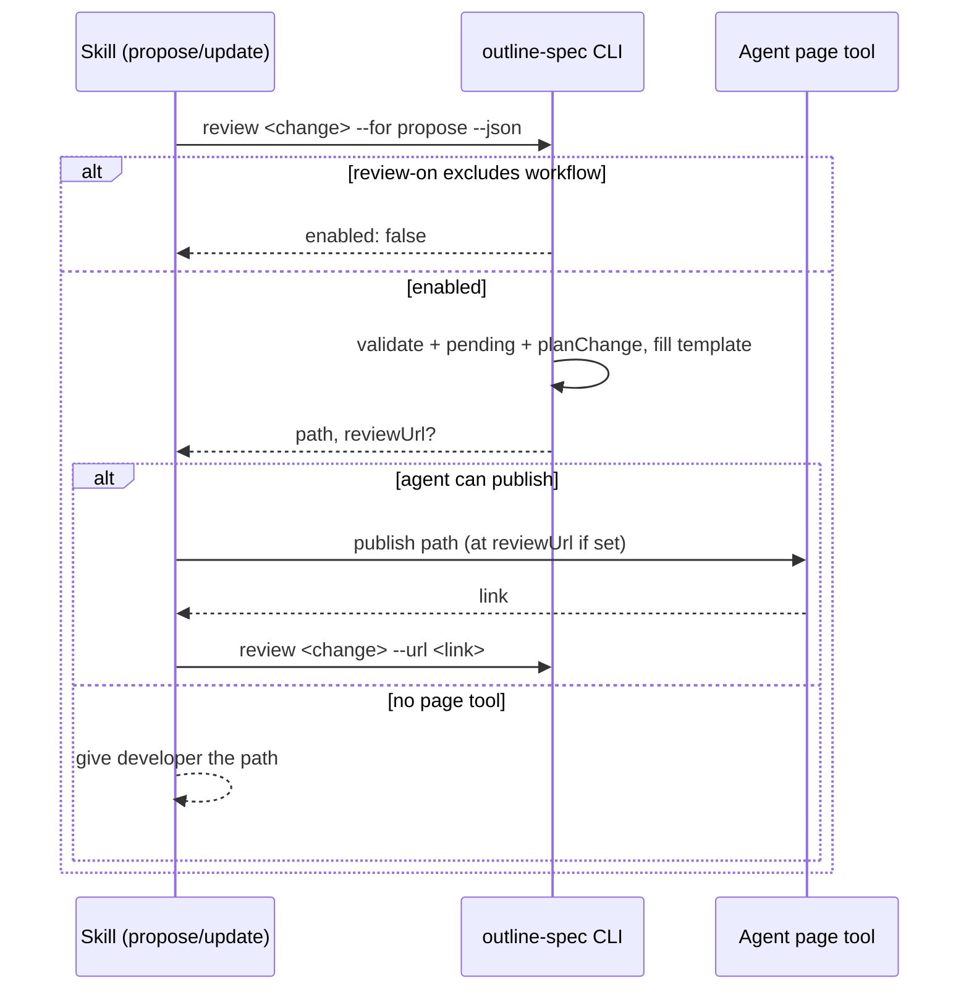

# Diagrams

How a propose ends with a page, and how an update republishes it.

<sub>Propose and update flow</sub>



Where each setting comes from; config wins over schema.

<sub>Resolution of review settings</sub>

| Setting | Schema `review` block | `config.yaml` | Default |
|---|---|---|---|
| Which workflows render | — | `review-on` | `[propose, update]` |
| Tabs | `tabs` | `review.tabs` (replaces) | outline schema's three tabs |
| Template | `template` (fork to replace) | — | `review.html` |

<sub>Default page</sub>

```
┌ review-page ─────────────────────────────────────────┐
│ ✓ Valid · overlaps add-foo on review-page.Tabs       │
├──────────┬───────────┬──────────────────────────────┤
│ Outline  │ Diagrams  │ Spec changes                 │
├──────────┴───────────┴──────────────────────────────┤
│ review-page  NEW                                     │
│   Review command   ADDED   …                         │
│ config-loading                                       │
│   Use resilient field-by-field parsing   EDITED      │
│     live │ after archive (changed words marked)      │
└──────────────────────────────────────────────────────┘
```
