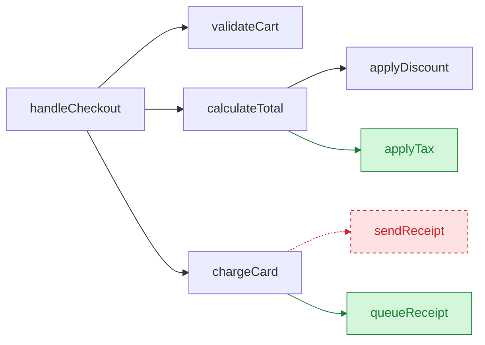
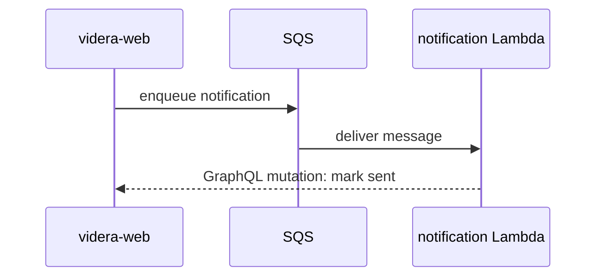
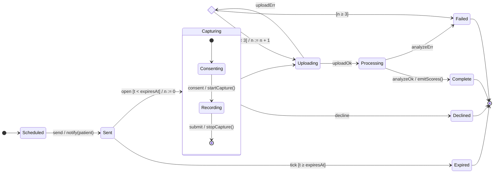

# Diagrams

## Datomic Schema
Use anytime a Datomic attribute has been added or altered.

Show attribute changes as a diff of the entity's `schema` vector. Include `:target` for refs.

```diff
 [{:db/ident       :assessment/status
   :db/valueType   :db.type/ref
   :db/cardinality :db.cardinality/one}
+ {:db/ident       :assessment/reviewed-by
+  :db/valueType   :db.type/ref
+  :db/cardinality :db.cardinality/one
+  :target         :user}]
```

If there are custom migrations (not schema-only migrations) include them verbatim here in a clojure code block.

## GraphQL Contract
Use when a GraphQL schema has been added or edited.
Show the schema EDN (or SDL) that clients see: new fields, args, mutations, and which resolver owns them.

```diff
 :Assessment
 {:fields {:id     {:type (non-null ID)}
           :status {:type :AssessmentStatus}
+          :reviewedBy {:type :User
+                       :resolve :assessment/reviewed-by}}}
```

If there are new mutations, show the auth conditions here as a clojure block, prefixing with a subsection labeled `Auth:`

## Data Shapes
Use anytime a request/response model changes that cannot be expressed using the GraphQL block.
For example a non-GraphQL endpoint, an S3 document or a payload to a lambda or step function.
Show a sample request, with comments describing anything unusual.

```clojure
{:session/id       #uuid "..."
 :session/patient  {:patient/guid #uuid "..."}
 :session/trigger  :trigger/on-demand ; other values are :trigger/change or :trigger/scheduled
 :session/expires  #inst "..."}
```

## Pseudocode
Use when there are significant code changes, and listing all of it would be too verbose (over 30 lines of code).
This is especially useful for changes that involve intricate logic, and most of that is business rules.
Do not just translate existing code to pseudocode; this should be a condensing of code and much simpler.

```diff
 on submit-assessment
-  save answers
+  if assessment already reviewed
+    reject with :already-reviewed
+  save answers
+  notify care team
```

## File Tree
Use when there were significant directory refactors such as moving files to different directories or a new directory added.
This is for when the change is about the dir structure itself, not just when new files or dirs were added in the course of the change.
Show file responsibilities or a broad refactor as a shallow tree with a comment per entry.

```diff
 src/clj/videra_web/
 ├── db/entities/
+│   └── review.clj        # review entity schema + helpers
 ├── resolvers/
-│   └── assessment.clj
+│   ├── assessment.clj    # read paths only
+│   └── review.clj        # review mutations
```

## Call Tree
Use call trees when trying to describe how multiple callers invoke a function or behavior.
Sequence diagrams are preferable to call trees for showing how data flows through the system.
Use colors (red and green) to show the addition and removal of callers.

Show runtime control flow as a call tree.



## Sequence Diagrams
Use Mermaid when describing complex system behavior.
This is the most expressive and useful diagram.
Especially use it when the flow crosses services (web app, Lambdas, Step Functions, queues, third-party APIs).
Use colors red and green to show addition and removal of calls.




## Table
Use tables when describing how behavior is similar and differs for different scenarios.
Use between 2 and 6 table columns.

```markdown
| Attribute | Merge rule | Code |
|---|---|---|
| `dob`, `gender`, `race`, `timezone` | Source if it has a value, otherwise target | [L55–60][a] |
| `terms-granter` | Same rule, but the target's value is kept if the target has accepted terms (ST-12776) | [L57][a2], [L331][g] |
| `guid`, `global` | Always the target's | [L84][b] |
| `deleted` | Deleted only if both patients are deleted | [L66][c] |
| `care-status` (per facility) | Active if either patient is active | [L61][d] |
| Unacknowledged red/yellow alert counts | Summed | [L67][e] |
| Terms accepted (booleans) | True if either patient accepted | [L70][f] |
| Terms accepted datetime | Earliest | [L74][f2] |
| Terms version accepted | Highest | [L78][f3] |

[a]: https://github.com/Videra-Health/videra-web/blob/dc60d804c/src/clj/videra_web/db/entities/patient/merge.clj#L55-L60
[a2]: https://github.com/Videra-Health/videra-web/blob/dc60d804c/src/clj/videra_web/db/entities/patient/merge.clj#L57
[b]: https://github.com/Videra-Health/videra-web/blob/dc60d804c/src/clj/videra_web/db/entities/patient/merge.clj#L84
[c]: https://github.com/Videra-Health/videra-web/blob/dc60d804c/src/clj/videra_web/db/entities/patient/merge.clj#L66
[d]: https://github.com/Videra-Health/videra-web/blob/dc60d804c/src/clj/videra_web/db/entities/patient/merge.clj#L61-L65
[e]: https://github.com/Videra-Health/videra-web/blob/dc60d804c/src/clj/videra_web/db/entities/patient/merge.clj#L67-L68
[f]: https://github.com/Videra-Health/videra-web/blob/dc60d804c/src/clj/videra_web/db/entities/patient/merge.clj#L70-L72
[f2]: https://github.com/Videra-Health/videra-web/blob/dc60d804c/src/clj/videra_web/db/entities/patient/merge.clj#L74-L76
[f3]: https://github.com/Videra-Health/videra-web/blob/dc60d804c/src/clj/videra_web/db/entities/patient/merge.clj#L78-L80
```

## State Machine
Use a state machine diagram to describe any complex logic that transitions the state (data) of an entity or of the system.
Use formal appearance and syntax, and red/green colors to show additions or removals.
Clearly label the states, transitions, entry points, etc.

Example:


## Contracts
Use contracts to simplify the description of a complex system instead of code.
Contracts describe:
   Invariants - Things that should always be true about the system (e.g. :patient/guid is never null)
   Boundaries - Things the system should never do (e.g. Should never merge a deleted patient)
   Pre/Post conditions - Things that should be true before invoking the system and afterwards

## Glossary
Use this when the change introduces many new words with precise meanings.
Define each word in a definition list using domain language.

Example:
* patient - A consumer of healthcare services
* user - A provider, support staff, or admin who logs in to Videra's system not to receive healthcare, but to facilitate it
* session - An assignment to a patient to fulfill a certain assessment